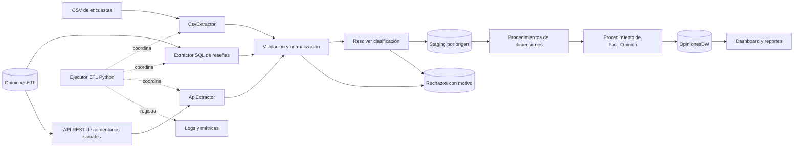
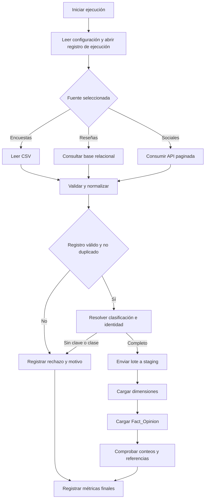
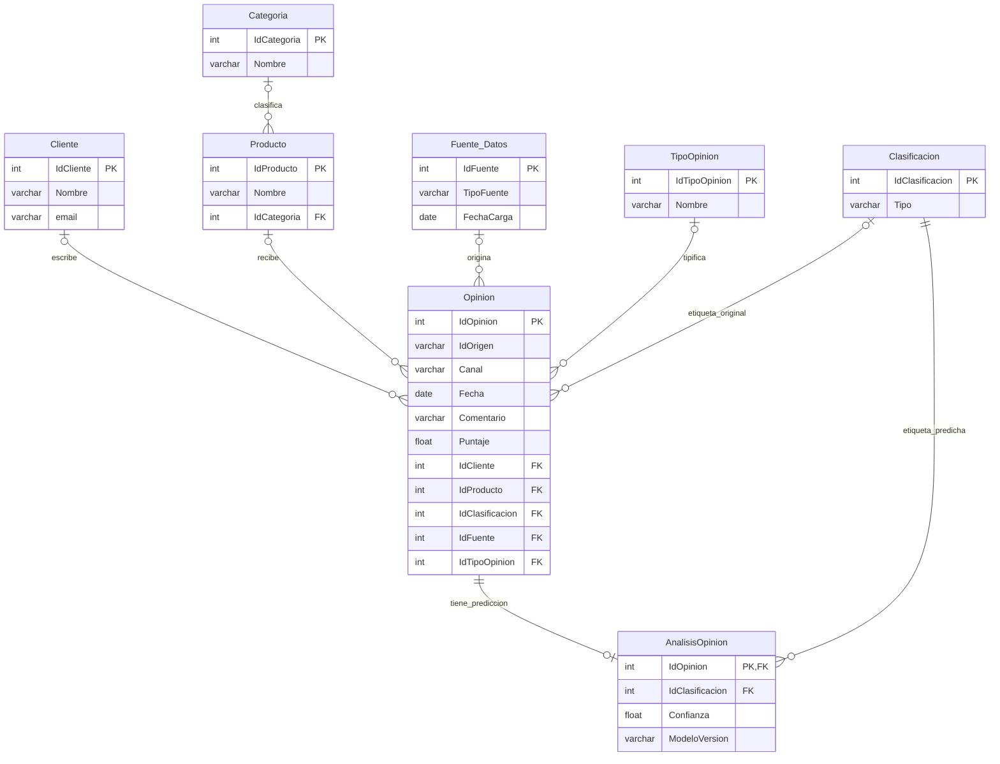
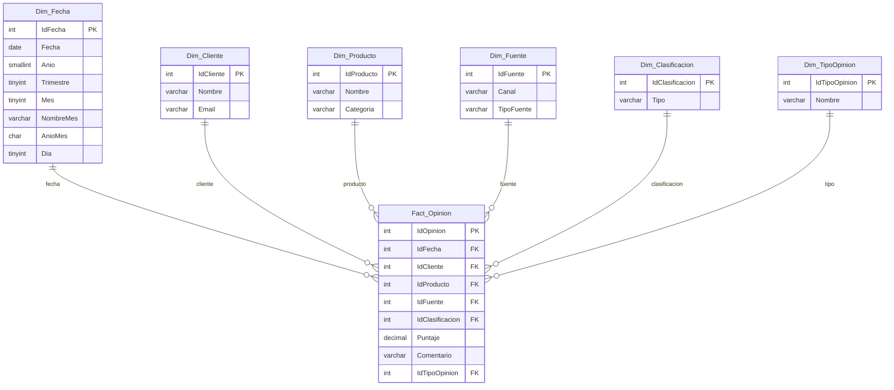

# Diseño del ETL de opiniones

Base de referencia: scripts de `OpinionesETL` y `OpinionesDW` entregados el 11 de noviembre de 2026. Los diagramas de las bases describen el esquema existente; los de arquitectura y flujo describen la implementación objetivo. La API, el extractor HTTP, staging, las rutas de carga por conjuntos y los procedimientos de dimensiones y FACT están implementados. `main.py` conserva el proceso histórico; la preparación selectiva se ejecuta con `python -m tools.prepare_analytic_staging` y la opción `--load` añade la llamada ordenada a dimensiones y FACT.

## 1. Arquitectura propuesta

La API lee opiniones sociales ya cargadas en `OpinionesETL`; no vuelve a insertarlas allí. El extractor SQL selecciona reseñas de la misma base. El CSV aporta los atributos de las encuestas. Los catálogos relacionales aportan los atributos de las dimensiones. La clasificación usa primero la etiqueta original y después la predicción existente; cuando faltan ambas se aplica el clasificador del proyecto solo a las filas seleccionadas.

## 2. Flujo de extracción y carga

## 3. Base relacional existente

Las referencias de `Opinion` son anulables en el script. La relación con `AnalisisOpinion` es de cero o una predicción por opinión. La clasificación original y la predicha se conservan por separado.

## 4. Base analítica existente

`Fact_Opinion` representa los tres tipos de opinión; el tipo distingue encuesta, reseña y comentario social. Las seis claves foráneas son obligatorias. `IdOpinion` es una clave primaria entera sin `IDENTITY` en el DW.

## 5. Contrato de extracción y preparación

Una fila aceptada representa una opinión. `IdTipoOpinion` y `IdOrigen` identifican su procedencia; `IdOpinion` es la clave entera que exige la FACT. La extracción social y relacional usa los valores ya guardados en `Opinion`. Para encuestas, los atributos de negocio salen del CSV y la base relacional solo aporta catálogos y la correspondencia de identidad.

| Campo normalizado | Encuesta: `surveys_part1.csv` | Reseña: SQL relacional | Social: API local |
|---|---|---|---|
| `IdTipoOpinion` | Constante `1` | `Opinion.IdTipoOpinion = 2` | `Opinion.IdTipoOpinion = 3` |
| `IdOrigen` | `IdOpinion` del CSV, como texto | `Opinion.IdOrigen` | `Opinion.IdOrigen` |
| `IdOpinion` para FACT | Buscar `Opinion.IdOpinion` por tipo `1` + `IdOrigen` | `Opinion.IdOpinion` | `Opinion.IdOpinion` |
| `IdCliente`, `IdProducto` | Columnas homónimas del CSV | Columnas de `Opinion` | Columnas de `Opinion` |
| `Fecha`, `Comentario` | Columnas homónimas del CSV | Columnas de `Opinion` | Columnas de `Opinion` |
| `IdFuente`, `Canal` | Constantes `2`, `Encuestas` del pipeline vigente | `Opinion.IdFuente`, `Opinion.Canal` | `Opinion.IdFuente`, `Opinion.Canal` |
| `Puntaje` | `PuntajeSatisfacción`, obligatorio | `Opinion.Puntaje`, obligatorio según el pipeline vigente | `Opinion.Puntaje`; puede ser nulo |
| Clasificación original | `Clasificación`: Positiva=`1`, Negativa=`2`, Neutra=`3` | `Opinion.IdClasificacion` | `Opinion.IdClasificacion` |
| Clasificación predicha | No aplica si la etiqueta CSV es válida | `AnalisisOpinion.IdClasificacion` | `AnalisisOpinion.IdClasificacion` |

El campo `Fuente` del CSV de encuestas no se carga actualmente: el pipeline asigna `IdFuente=2` y `Canal=Encuestas`. Los archivos `web_reviews.csv` y `social_comments.csv` son muestras históricas y no son fuentes del nuevo flujo analítico. La API social expone los campos relacionales necesarios y las dos clasificaciones, ordenados y paginados por `IdOpinion`; no expone nombres ni correos de clientes.

### Reglas comunes

1. **Clasificación efectiva:** usar la original si existe; en otro caso, la predicha. En este paso, una fila sin ambas queda registrada como rechazo `sin_clasificacion_valida`, pendiente de clasificación selectiva antes de cargar la FACT. La integración futura del clasificador procesará solo el lote seleccionado y conservará la predicción por separado en `AnalisisOpinion`. La FACT requiere una clase válida entre `1`, `2` y `3`.
2. **Identidad:** las seis encuestas válidas actuales tienen correspondencia por `(IdTipoOpinion=1, IdOrigen)` con un `IdOpinion` relacional y con la FACT existente. Una encuesta futura sin correspondencia queda pendiente con motivo `sin_id_opinion_relacional`; la estructura actual de la FACT no permite asignarle un entero seguro sin definir una nueva política de identidad.
3. **Integridad:** exigir fecha, texto, identificador de origen, cliente, producto, fuente, tipo y clasificación válidos. `Puntaje` es obligatorio para encuestas y reseñas; en comentarios sociales puede ser nulo. Si viene informado debe estar entre `1` y `5`. La validación aplica esta regla según el tipo de opinión. Rechazar o dejar pendiente una fila con referencias o atributos dimensionales faltantes, sin inventar clientes, productos ni miembros desconocidos.
4. **Dimensiones:** `Dim_Cliente` toma nombre y correo de `Cliente`; `Dim_Producto`, nombre y categoría de `Producto` y `Categoria`; `Dim_Fuente`, canal de la opinión y tipo de `Fuente_Datos`; `Dim_TipoOpinion` y `Dim_Clasificacion`, sus catálogos; `Dim_Fecha` deriva `IdFecha=AAAAMMDD` y los atributos calendario. El mismo `IdFuente` no puede asociarse a canales distintos en un lote ni entre cargas, porque es la única clave de `Dim_Fuente`.
5. **Staging y cargas por conjuntos:** `sql/004_Staging.sql` crea `Stg_Opinion` y `Stg_Rechazo` en `OpinionesDW`. Conservan `IdEjecucion`, origen, identificadores, campos normalizados, clasificaciones original, predicha y efectiva, y el motivo de cada rechazo. `sql/005_TVP_Social.sql` carga comentarios de API mediante TVP; `sql/006_Bulk_Encuestas.sql` recibe un CSV temporal de encuestas ya validadas; `sql/007_Reviews_Set.sql` selecciona reseñas tipo 2 mediante `INSERT … SELECT`. El modo automático intenta BULK y usa `pyodbc.fast_executemany` solo si SQL Server no puede abrir o leer el archivo. `sql/008_Rechazo_IdOrigen.sql` amplía el identificador de rechazos en instalaciones existentes. `sql/009_Dim_Clasificacion.sql` a `sql/014_Dim_Fecha.sql` cargan las seis dimensiones y `sql/015_Fact_Opinion.sql` carga los hechos por conjuntos.
6. **Idempotencia:** deduplicar por `(IdTipoOpinion, IdOrigen)` en la entrada y por `IdOpinion` al cargar la FACT. La carga repetida no debe crear hechos adicionales ni reclasificar registros ya analizados.

### Alcance observado

La validación de la instancia encontró `6` encuestas, `200` reseñas y `112` comentarios sociales en la base relacional y los mismos `318` hechos en el DW. El CSV contiene `500` encuestas; `494` carecen de cliente o producto válido respecto de los catálogos actuales y se registraron en `Stg_Rechazo`. Estos números son una línea base de comprobación, no constantes del programa.

## 6. Límites del diseño

- El esquema no tiene estado de publicación. El proyecto vigente trata todas las opiniones de tipo `2` como reseñas publicadas; el nuevo extractor seguirá esa regla.
- `sp_LimpiarBaseDatosETL` borra datos y no forma parte del flujo selectivo ni de sus pruebas ordinarias.
- Los procedimientos de dimensiones y FACT están instalados y probados en SQL Server con el lote selectivo. La orquestación Python usa `--load` al preparar o `--load-existing-batch` para un lote ya preparado. Las tres rutas de staging por conjuntos están implementadas y probadas por separado.
